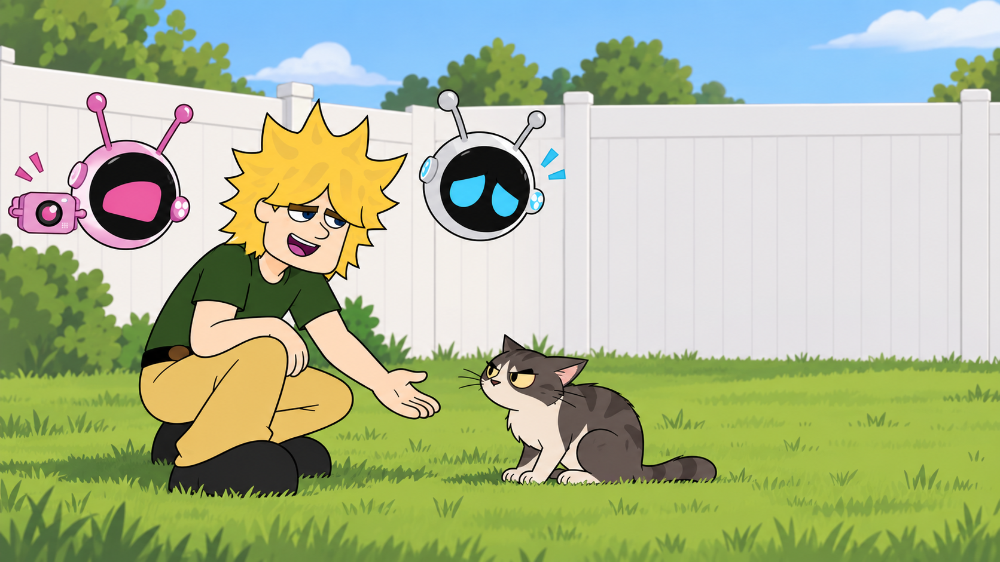
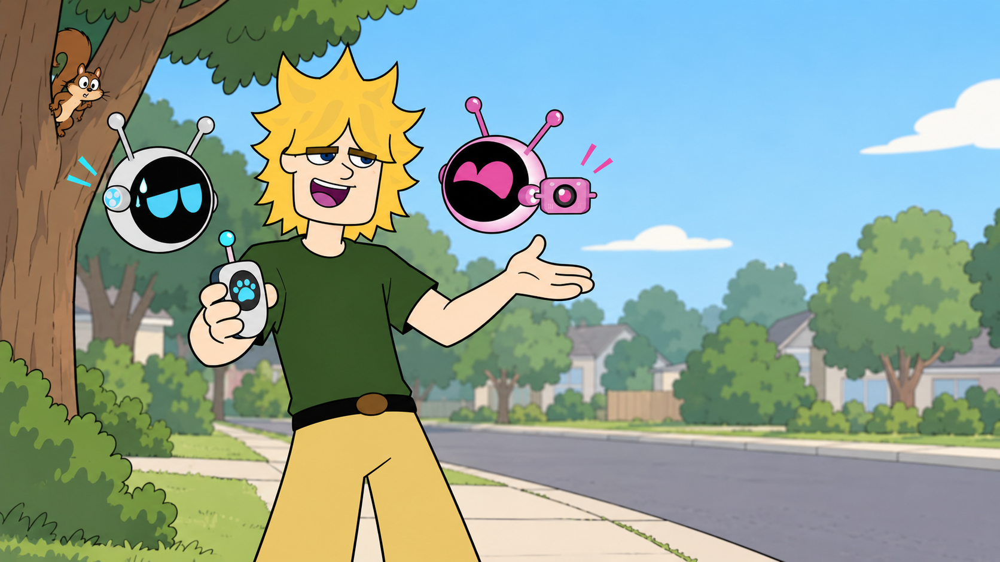

# Earth To Jay — Voice Acting & Writing Portfolio

**Created and written by Joseph Edwards**

An original animated adventure-comedy about Jay, a brilliant inventor with uneven judgment, who wants to meet Earth's animals and make the top nature show on ViewTube. His robot companions Hank and Jess help keep the expedition, the camera, and Jay's plans from going too far off course.

## What this portfolio shows

- Original series concept and character writing
- Scripted performance as Jay and Hank, including distinct character voices
- Character designs and AI-assisted visual development

## Performance sample

[Read the opening excerpt](script-sample/opening-excerpt.fountain) from the pilot. A finished reel will be linked here after the split-screen edit is ready.

## Visual development

These AI-assisted concept frames were generated from Joseph Edwards's character-design references for portfolio storyboarding. They are illustrative development images, not production-ready character sheets.

## Rights

© 2026 Joseph Edwards. All rights reserved. This repository contains selected portfolio samples. No license is granted to reproduce, adapt, perform, distribute, or commercialize the scripts, characters, or artwork. Contact the creator for permission.

The full pilot, series bible, private creator notes, source artwork, and production files are intentionally not included. Do not add a software or Creative Commons license to this repository.
