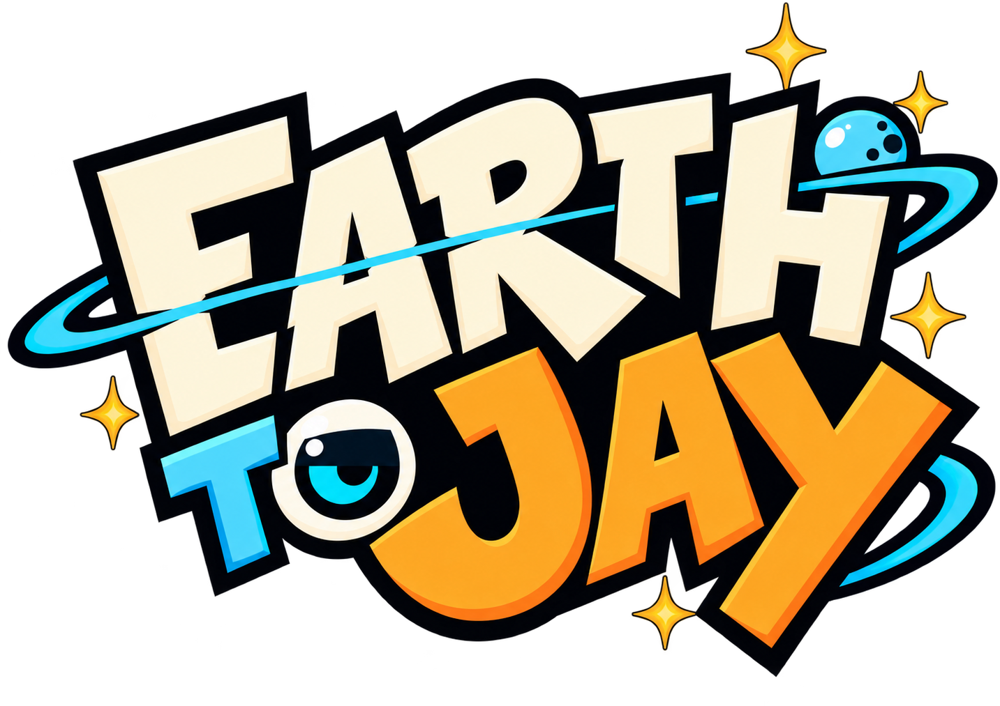
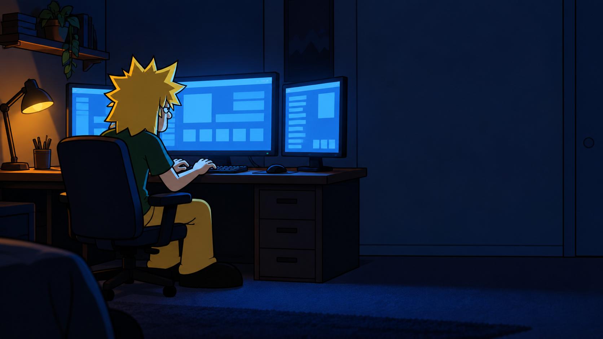

  

<h3 align="center">An original animated adventure comedy</h3>

  <strong>Created and written by Joseph Edwards</strong> 
  Voice acting · character performance · scriptwriting · show development 
  <strong>Voice performance reel in production</strong>

---

## The show

Jay is a brilliant young inventor with uneven judgment and one enormous goal: meet Earth's animals and make the greatest nature show on ViewTube. His floating robot companions, Hank and Jess, handle the camera, the commentary, and as much damage control as the day requires.

*Earth To Jay* combines character comedy, animal encounters, improvised energy, and a sincere curiosity about the natural world.

## Portfolio focus

| Discipline | Featured work |
| --- | --- |
| **Voice acting** | Jay and Hank character performances; public voice performance reel in production |
| **Writing** | Original series concept, pilot script, character dialogue, comic timing, and scene construction |
| **Character work** | Original characters, relationships, performance direction, and visual development |
| **Show development** | Series premise, tone, episode structure, and reel planning |

## Featured script sample

**[Read the opening excerpt from the “Cats” pilot →](script-sample/opening-excerpt.fountain)**

The excerpt introduces Jay and Hank through a fast misdirect: what sounds like a critical invention test is actually the final moment of a video game. It establishes their voices, comic timing, and relationship before Jay launches into the episode.

The sample is provided in Fountain screenplay format, which is readable as plain text.

## Performance reel

The voice and acting reel is currently in production. It is being designed as a split-screen performance with Joseph on camera alongside illustrated story frames from the pilot.

The finished reel will feature original writing and character performances created specifically for *Earth To Jay*.

## Visual development

  

<em>Jay at work — an AI-assisted storyboard concept developed from Joseph Edwards's original character references.</em>

Visuals shown here are portfolio development material. They demonstrate staging, tone, lighting, and reel planning; they are not production-ready model sheets.

## Credits and rights

*Earth To Jay* is an original series created and written by **Joseph Edwards**. The script, characters, series concept, and underlying creative material are © 2026 Joseph Edwards. All rights reserved.

This repository is a view-only portfolio presentation. No license is granted to reproduce, adapt, perform, distribute, train on, or commercialize its scripts, characters, artwork, or other materials. The complete pilot, series bible, private creator notes, source artwork, and production files are intentionally withheld.

For casting, collaboration, or portfolio inquiries, contact Joseph Edwards through the [RawPowered GitHub profile](https://github.com/RawPowered).
