# AI art direction and rejection study

> **Portfolio case study — intentionally rejected work**  
> Every image in the `rejected` folder is off-model development material. These images are presented to document critique, iteration, and visual decision-making; they are not approved production designs.

## Purpose

AI image generation can produce an attractive frame while still missing the character, story beat, or design system. This review shows how I evaluated generated concepts for *Earth To Jay*, identified concrete discrepancies, and converted those failures into a tighter visual brief.

The original series concept, characters, story direction, acceptance criteria, and critique are by **Joseph Edwards**. The rejected images are AI-assisted development outputs made under that direction.

## Approved direction: Shadow

  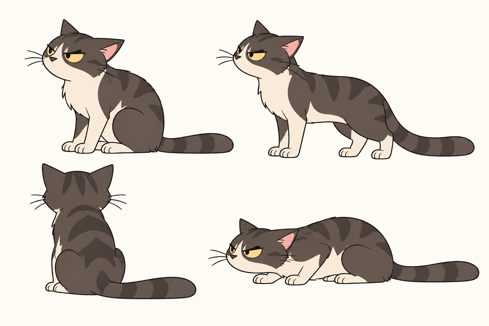

The accepted direction uses a low, compact build; short, economical fur shapes; broad gray-and-white markings; and narrow, half-lidded amber eyes. The design communicates Shadow's guarded, weary attitude without relying on exaggerated cuteness or realistic texture.

## The design rules being tested

| Area | Current reel-frame direction |
| --- | --- |
| **Shadow** | Low, compact body; short simplified fur; narrow half-lidded amber eyes; dry, skeptical attitude |
| **Jay** | Consistent face and silhouette; readable but restrained acting; flat 2D graphic treatment |
| **Hank and Jess** | Floating spheres with exactly two antennae; no arms, hands, legs, feet, torso, or neck |
| **Bot displays** | One front display graphic; no pupils or irises; a simple round dot may be used for a neutral state |
| **Scene style** | Clean linework, simplified shapes, controlled detail, and a consistent rendering language across characters |
| **Story fidelity** | Staging must preserve the written action, character intent, and comic tone rather than invent a more dramatic beat |

## Ten rejection decisions

| # | Discrepancy | What the review caught |
| --- | --- | --- |
| 01 | Detail and eye-language drift | Shadow became fluffy, elegant, and green-eyed |
| 02 | Cuteness and proportion drift | Oversized round eyes and upright proportions softened the character |
| 03 | Silhouette near-miss | The face improved, but the body still lacked the intended low, grounded build |
| 04 | Narrative action drift | A cautious encounter was changed into an attack |
| 05 | Rendering-style collision | A painterly cat was placed beside flatter graphic characters |
| 06 | Invented robot anatomy | Hank was given a torso, shoulders, arms, and hands |
| 07 | Pupil and extra-eye read | Display details and side hardware created an unintended multi-eye face |
| 08 | Expression and tone drift | Giant anime tears replaced restrained comic acting |
| 09 | Compounded model drift | Bot anatomy and Shadow's eye/build rules failed in the same frame |
| 10 | Locomotion continuity failure | Floating bots suddenly became walking humanoids |

---

## 01 — Shadow: detail and eye-language drift

  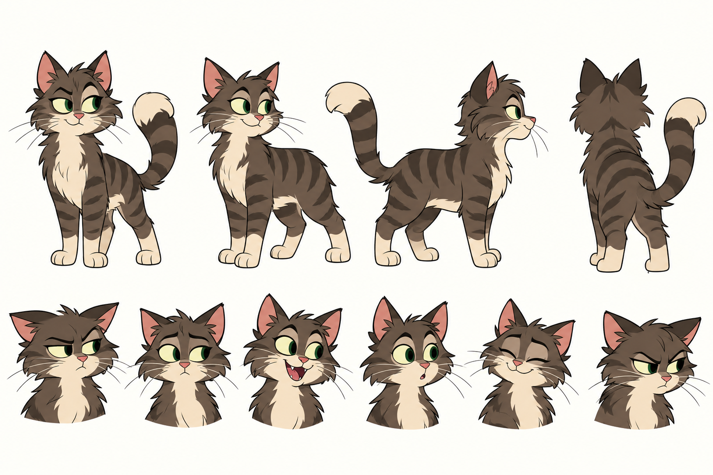

**Rejected because:** Long layered fur, a tall elegant stance, a curled presentation tail, and large green eyes make Shadow feel polished and conventionally appealing. They do not communicate the blunt, low-energy personality established for the character.

**Design principle:** Surface detail cannot substitute for character specificity. Eye shape, posture, and silhouette must carry the attitude before texture is added.

**Correction:** Shorten the fur language, lower the body, simplify the markings, and use narrow half-lidded amber eyes.

## 02 — Shadow: cuteness and proportion drift

  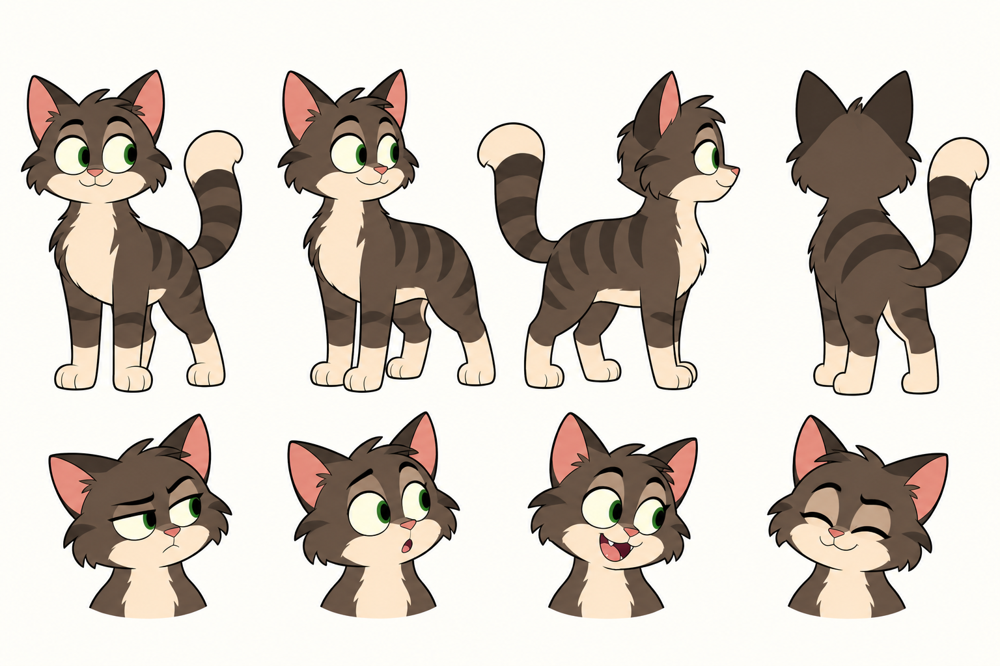

**Rejected because:** Simplifying the fur solved one problem but introduced another. The oversized eyes, rounded muzzle, small body, and cheerful neutral poses push the design toward a cute kitten archetype.

**Design principle:** Simplification must preserve personality. A cleaner drawing is not successful if the emotional read changes.

**Correction:** Reduce the eye size, flatten the upper lids, widen and lower the body mass, and keep the resting expression skeptical rather than eager.

## 03 — Shadow: silhouette near-miss

  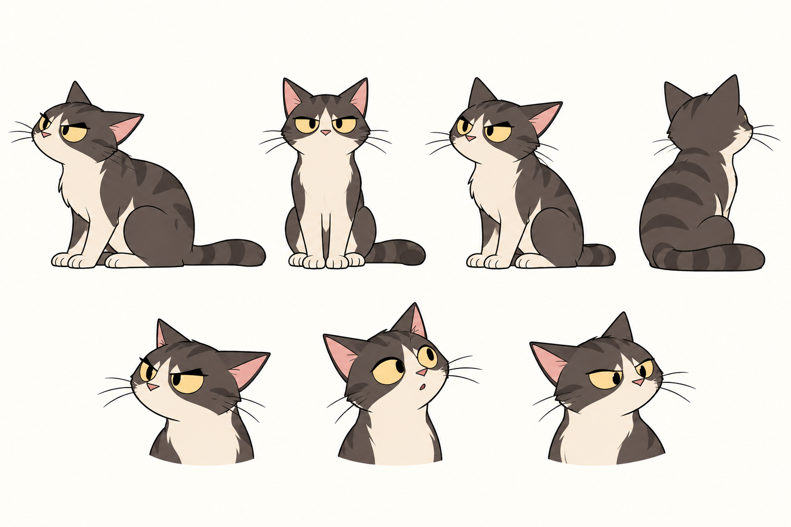

**Rejected because:** This pass found the correct amber color and much better eyelid language, but the seated poses remain upright and tidy. The character still reads as posed for a model sheet instead of carrying weight close to the ground.

**Design principle:** A successful face does not rescue an incorrect body read. Character attitude has to survive in the full silhouette.

**Correction:** Preserve the eye treatment while compressing the torso, lowering the shoulders, and adding a grounded crouch to the final reference.

## 04 — Narrative action drift

  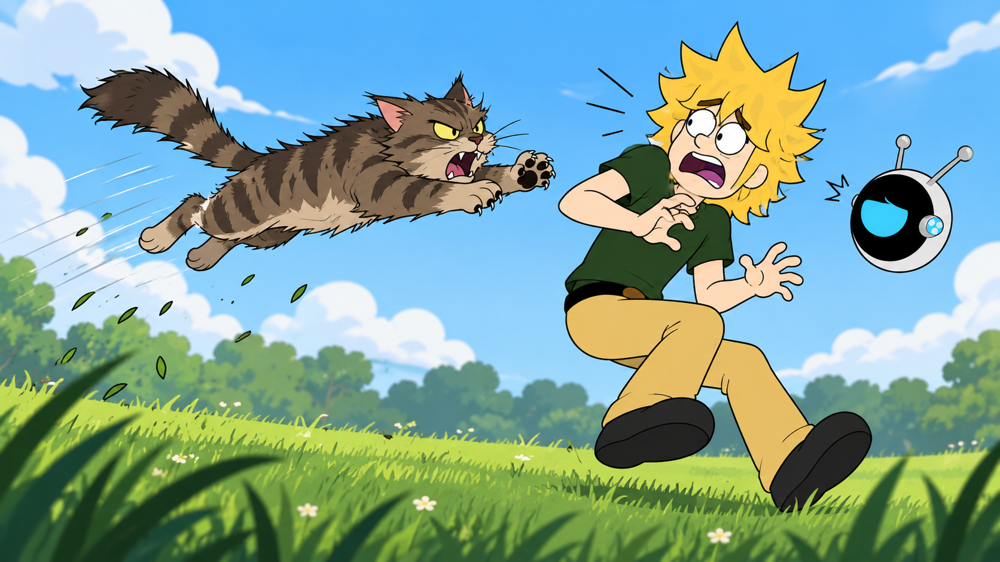

**Rejected because:** The generated image turns a wary animal encounter into a full airborne attack. That changes the written beat, makes Jay appear to be in immediate danger, and shifts audience sympathy toward spectacle rather than observation.

**Design principle:** Storyboard art is an interpretation of the script, not a license to replace its action with a more sensational one.

**Correction:** Keep Shadow defensive and retreating, keep Jay unharmed, and stage the tension through spacing and posture.

## 05 — Rendering-style collision

  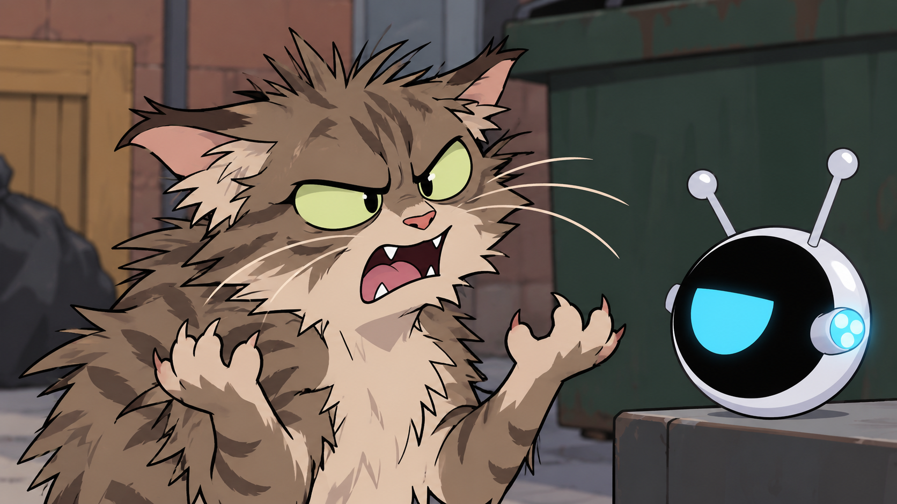

**Rejected because:** Shadow is rendered with dense fur spikes, layered values, realistic claws, and glassy eyes while Hank is treated as a smooth graphic object. They look imported from different productions.

**Design principle:** Detail density is part of model consistency. Characters sharing a frame need compatible line, shape, and shading systems.

**Correction:** Use fewer fur breaks, flatter color groups, simpler eyes, and the same contour economy used throughout the cast.

## 06 — Invented robot anatomy

  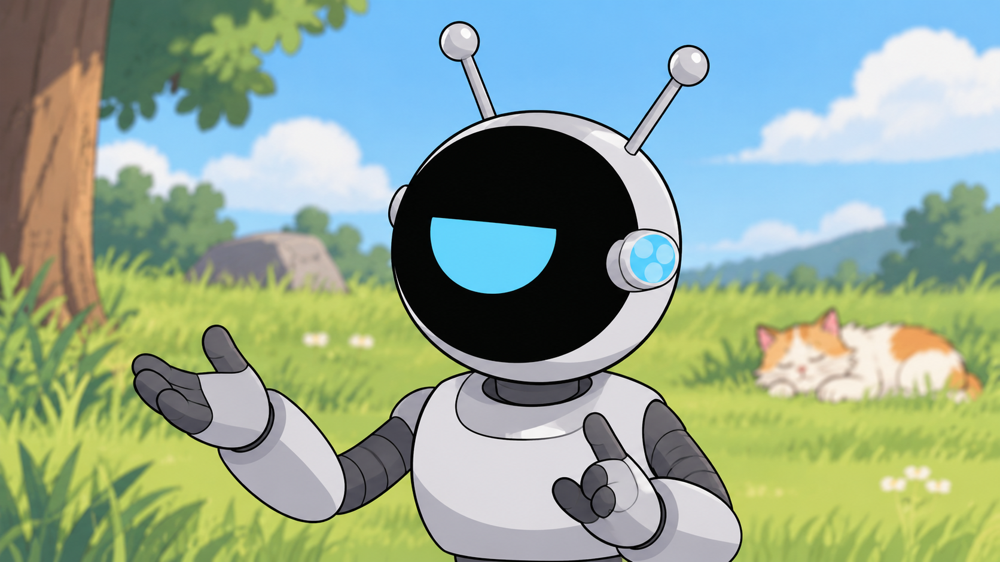

**Rejected because:** The image turns Hank's floating sphere into the head of a humanoid robot. The shoulders, torso, segmented arms, and gesturing hands erase the intended silhouette and change how the character occupies space.

**Design principle:** A strong character silhouette is structural, not optional. Familiar anatomy should not be added merely because a pose would be easier to humanize.

**Correction:** Remove every body part below or beside the sphere and communicate performance through hover height, tilt, antenna angle, and the display graphic.

## 07 — Pupil and extra-eye read

  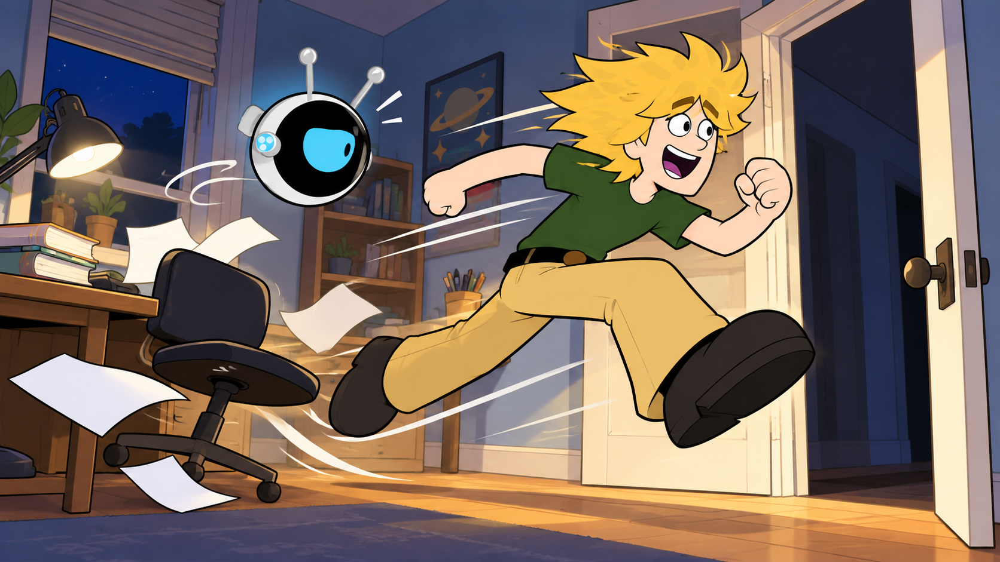

**Rejected because:** A small dark oval inside the cyan display reads like a pupil. The bright circular side element reinforces the impression of an additional eye, making the face anatomy ambiguous.

**Design principle:** The bot display is a graphic symbol, not an eyeball. Small interior marks and lens-like side details can accidentally turn an abstract expression into a conventional face.

**Correction:** Keep the front symbol flat and pupil-free. In relaxed states, use only a single simple dot when needed; remove competing eye-like details from the read.

## 08 — Expression and tone drift

  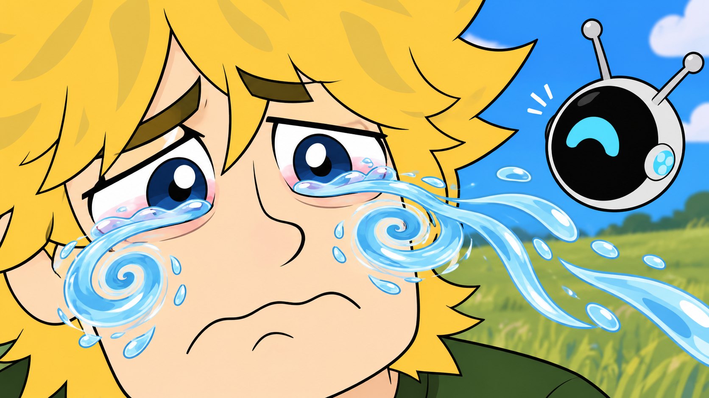

**Rejected because:** The enormous spiraling tear streams dominate the composition and shift the acting into a broad anime gag. The effect overwhelms Jay's performance and breaks the dry comic tone established elsewhere.

**Design principle:** Expression intensity has to match the scene's dramatic scale and the show's visual vocabulary.

**Correction:** Let brows, eyelids, mouth shape, timing, and vocal performance carry the emotion; use tears only if the script actually requires them.

## 09 — Compounded model drift

  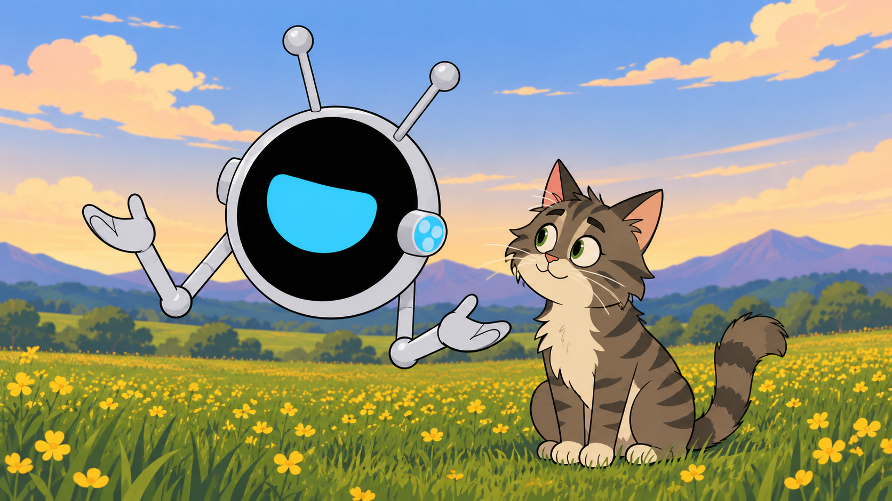

**Rejected because:** Multiple locked rules fail at once: Hank gains arms and hands, Shadow regains large green eyes and a cute upright build, and both characters become more generically expressive than their models allow.

**Design principle:** A frame is only as consistent as its weakest model. Review must check every character, not just the focal subject.

**Correction:** Run a per-character checklist before accepting composition, lighting, or background polish.

## 10 — Locomotion continuity failure

  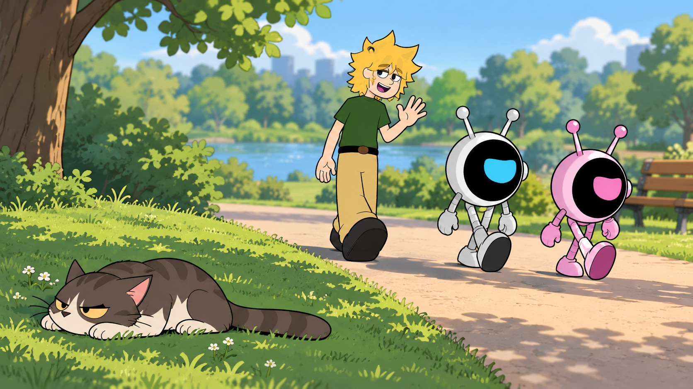

**Rejected because:** Hank and Jess suddenly walk away on arms and legs after being established as floating spheres. The change is especially damaging in a sequence because it alters scale, locomotion, silhouette, and personality at the same time.

**Design principle:** Continuity is not limited to color and costume. A character's physical rules must remain stable from shot to shot.

**Correction:** Keep both bots airborne and stage the exit with hover paths, spacing, tilt, and antenna gesture.

## What the rejected work changed

These failures led to a more explicit visual-control process:

1. Lock a reference sheet before scene generation.
2. Separate non-negotiable model rules from scene-specific direction.
3. Check silhouette and eye language before judging polish.
4. Compare every generated frame against the written action.
5. Review all characters in a shot for continuity, including background figures.
6. Reject attractive images when they solve the wrong problem.

That last step is the core of the case study: art direction is not choosing the most polished result. It is choosing the result that belongs to the character, the scene, and the show.

## Rights and use

*Earth To Jay* and its characters, scripts, designs, art direction, and underlying creative material are © 2026 Joseph Edwards. All rights reserved. These images are published only as portfolio evidence of development and critique. No permission is granted to reproduce, adapt, perform, distribute, train on, or commercialize them.

[← Return to the main portfolio](../README.md)
